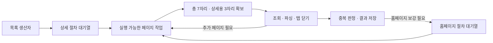

# 수집 엔진 운영 구조

기본 실행은 **상세 우선 수집**이다. 총 7개 페이지 슬롯 중 사람인 상세용 3자리를 확보하고, 수집 중 홈페이지는 최대 4개 슬롯에서 실행한다. 준비된 상세 요청을 먼저 배정하며 홈페이지 작업이 없으면 상세는 최대 7자리까지 사용할 수 있다. 모든 소스의 상세 조회와 취소 정리가 끝나면 예약을 풀어 홈페이지 보강이 7자리를 모두 사용한다. 브라우저 인스턴스는 하나이며 목록 전용 탭 1개를 포함해 최대 8개 탭을 사용한다.

기존 단계별 수집(상세 4개·홈페이지 3개)과 예약 없는 공용 수집도 비교용으로 유지한다. `RunOptions.sharedWorkers`는 1~8 범위다. 슬롯을 1개로 지정한 경우 상세 예약은 0개로 낮춰 홈페이지 대기열로 인한 교착을 막는다.

## 작업의 단위와 배정

- 하나의 실행 슬롯은 페이지 하나의 생성·조회·파싱·종료를 담당한다. 기업 상세에서 다른 기업 프로필이나 채용공고로 넘어갈 때, 홈페이지에서 연락처 페이지로 넘어갈 때 각각 자리를 반환하고 다음 페이지를 다시 대기열에 넣는다. 기업 처리 전체에 슬롯을 고정하지 않는다.
- 상세 우선 모드는 예약이 유지되는 동안 실행 가능한 상세를 먼저 배정하고 홈페이지 동시 실행을 4개로 제한한다. 예약 해제 후에는 모든 슬롯을 홈페이지에 배정할 수 있다. 예약 없는 공용 모드는 실행 가능한 종류를 번갈아 배정한다. 완료 결과는 요청 순서와 무관하게 즉시 저장한다.
- 사람인의 모든 페이지 이동은 소스별 요청 시작 간격(기본 500ms)을 공유한다. 상세 우선 모드는 확보한 슬롯 하나에서 다음 탭 준비를 대기 시간과 겹친다. 준비 중인 작업은 활성 슬롯에 포함되며 같은 소스에서 한 작업만 준비한다. 이동 직전에 비동기 시작 허가를 기다려 요청 간격을 지키고, 탭 준비 시간이 매 요청의 간격에 추가되는 것을 줄인다. 예약 없는 공용 모드는 간격을 기다리는 작업을 대기열에 둔다.
- 목록 페이지는 전용 생산자 탭에서 같은 요청 간격을 적용한다. 목록 이동 자체는 7개 작업 슬롯에 포함되지 않는다. 목록 요청도 같은 소스의 시작 허가를 순서대로 받아 상세 탭 준비 때문에 뒤로 밀리지 않는다.
- 홈페이지는 요청 URL의 호스트(www 별칭 제외)당 1개 페이지만 실행한다. 같은 호스트의 작업이 막혀 있어도 다른 호스트나 사람인 작업을 실행한다. 기업·번호 확보 정책은 유지하며 홈페이지에서 찾은 유효한 번호를 우선한다.

## 대기열, 저장과 취소

상세 입력·완료 결과 대기열은 각각 논리 상세 작업자 수의 2배(기본 상세 우선 모드는 14개), 홈페이지 절차 대기열은 최대 16개, 공용 페이지 대기열은 최대 20개다. 대기열이 가득 차면 상위 단계가 기다려 메모리와 미처리 작업 수를 제한한다. 절차별 동시 대기 수와 실제 페이지 실행 슬롯 수를 구분한다.

기업의 제외 조건·중복 판정·최대 건수 확인과 기본 저장은 단일 소비자에서 수행한다. 홈페이지 결과는 최신 DB 행을 읽은 뒤 보강 필드만 반영한다. 삭제한 행을 다시 만들지 않으며 관련 없는 사용자 수정은 보존한다. 홈페이지에서 번호를 못 얻으면 기존 사람인 번호를 유지한다.

기본 수집(`collecting`) → 홈페이지 잔여 보강(`enriching`) → 전체 종료(`done`)를 구분한다. 실행별 AbortController로 탭과 대기 작업을 취소하고, 실행 중 작업 정리가 끝난 뒤 완료 이벤트를 보낸다. 최대 저장 건수·403/429 차단 시에는 해당 소스의 선행 조회를 취소한다. 이미 저장한 기업의 홈페이지 보강은 계속한다.

홈페이지는 실제 페이지 작업에 메인·하위 페이지 합산 12초 예산을 적용한다. 공용 대기열에서 기다리는 시간은 이 예산에서 제외한다. 시간 초과·번호 미확보는 각각 표시하며 자동 재시도하지 않는다. 페이지를 닫는 OS 자체가 멈춘 상황까지 강제 종료하는 감시기는 아니다.

큐는 메모리에 있으며 앱 종료 후 미처리 작업을 자동 재개하지 않는다. 상세 예외의 backoff 동안에는 페이지 슬롯을 점유하지 않으며, 취소된 작업은 재시도하지 않는다.

## 비교 방법

수집 화면과 엔진의 기본값은 `RunOptions.schedulerMode = 'reserved'`다. 기존 방식은 `'staged'`, 예약 없는 공용 풀은 `'shared'`로 선택한다. 공용 슬롯의 기본값은 7개이고 예약 기본값은 3개다. `scripts/benchmark-50-live.js`는 고정된 50개 기업을 실제 검색·상세·홈페이지·DB 파일 쓰기까지 비교한다. 기본 비교 순서는 `staged,shared7,reserved7d3,reserved7d3,shared7,staged`다. `KEY_BENCH_50_MODES`의 `reserved7d3`은 7자리 중 상세 3자리 예약, `reserved7`은 상세 4자리 예약, `reserved8`은 8자리 중 상세 4자리 예약을 뜻한다. `scripts/summarize-benchmark-50.js <결과 폴더>`는 실제 저장된 DB를 다시 열어 건수·기업명·전화번호를 대조한다.

이전 소규모 비교용 `scripts/benchmark-shared-live.js`는 동일 후보 목록과 비어 있는 메모리 저장소에서 두 구조를 번갈아 실행하고 기업·번호·출처, 페이지 요청 수, 최대 탭 수를 기록한다. `KEY_BENCH_REFS`, `KEY_BENCH_MODES`(기본 `baseline,shared5,shared5,baseline`), `KEY_BENCH_BASELINE`으로 표본과 이전 소스 스냅샷을 지정할 수 있다. 스냅샷이 없으면 현재 소스의 `staged` 모드를 비교한다.

소규모 메모리 비교에서는 검색 목록 확보·세션 준비와 실제 DB 파일 쓰기를 제외했다. 실제 50개 비교에는 이를 포함하며, 기업 사전 선정과 앱·브라우저 시작만 제외한다. 외부 사이트 응답에 따른 편차를 확인하기 위해 개별값·평균·중앙값을 기록한다. 처리 결과와 번호 출처도 함께 확인한다.

`scripts/test-shared-scheduler.js`는 공유 슬롯 상한, 간격 대기 중 다른 작업 실행, 도메인 제한, 공정한 배정, 취소·오류 시 슬롯 반환을 검증한다. `scripts/benchmark-shared-fixture.js`는 로컬 서버의 1초 지연 페이지 5개를 실제 브라우저로 조회한다. 해당 통제 실험에서 순차 5.706초, 공용 5개 1.355초를 기록했으며 이는 사람인 전체 수집의 단축률이 아니다.

## 공용 풀 실측 결과

동일 후보 16개를 고정해 이전 소스 스냅샷의 단계별 구조와 최종 공용 풀을 각각 2회 비교했다. 추가로 같은 총 슬롯 수인 공용 7개도 2회 확인했다.

| 구조 | 기본 정보 저장 완료 | 보강 포함 전체 완료 | 최대 동시 작업 탭 |
|---|---:|---:|---:|
| 기존 단계별 4+3 | 9.37초 | 15.54초 | 7 |
| 공용 5개 | 11.22초 | 15.39초 | 5 |
| 공용 7개 | 10.29초 | 15.28초 | 7 |

모두 같은 기업 10개, 같은 번호 10개, 같은 번호 출처와 임직원 수를 확보했다. 상세 오류·차단은 없었고 홈페이지 시간 초과 1개·번호 미확보 2개도 같았다. 전체 완료 시간의 1~2% 차이는 이번 표본에서 속도 향상이 입증되었다고 해석하기 어렵다. 공용 5개는 동시 탭을 줄였지만 기본 정보 저장은 느려졌다. 따라서 속도 개선을 이유로 기본 모드를 교체하지 않았으며 공용 풀은 실험 모드로 제공한다.

원본: `logs/benchmark-shared-1793741998197/results.json`, `logs/benchmark-shared-1793742157101/results.json`. 이전 소스 스냅샷은 `logs/shared-pool-baseline/src`이며 Git에는 포함하지 않는다.

## 실제 50개 기업 추가 비교

2026-11-04 동일한 기업 50개를 고정해 각 방식으로 2회씩 총 6회 수집했다. 후보 75개에서 제외 조건을 통과한 서로 다른 50개를 사전 선정했으며, 비교 실행마다 빈 SQL DB와 새 브라우저 컨텍스트를 사용했다. 측정에는 실제 검색 목록 요청, 기업 상세, 홈페이지 보강, DB 파일 쓰기를 포함했다. 사전 선정과 앱·브라우저 실행 시간은 제외했다.

| 방식 | 50개 기본 정보 저장 평균 | 홈페이지 포함 전체 평균 | 개별 전체 측정값 |
|---|---:|---:|---|
| 기존 단계별 4+3 | 31.19초 | 43.23초 | 45.00초 / 41.46초 |
| 공용 5개 | 42.27초 | 43.07초 | 44.59초 / 41.56초 |
| 공용 7개 | 36.23초 | 36.97초 | 37.01초 / 36.93초 |

50개 표본에서는 공용 7개의 전체 완료 시간이 기존보다 평균 6.26초(14.48%) 짧았다. 기존은 마지막 기본 정보 저장 뒤 보강에 평균 12.04초가 더 걸렸고, 공용 7개는 0.74초였다. 기본 정보 저장만 보면 기존 방식이 빨랐다. 앞선 16개 표본의 작은 차이를 대량 수집 전체에 일반화해서는 안 된다.

각 실행의 실제 DB를 다시 열어 기업 50행·원본 50행을 확인했다. 여섯 실행 모두 같은 기업 50개와 같은 전화번호 값 50개를 확보했고 상세 오류·차단은 없었다. 일부 기업의 전화번호 출처(사람인/홈페이지)는 실행별로 달랐지만 번호 값은 같았다.

이 첫 50개 비교 직후에는 기본 설정을 유지했다. 이후의 최종 기본 배분은 아래 추가 검증으로 결정했다. 첫 비교의 원본 및 검증 요약은 `logs/benchmark-50-1793744061586/results.json`, `logs/benchmark-50-1793744061586/summary.json`이고, 재현 스크립트는 `scripts/benchmark-50-live.js`다. `KEY_BENCH_50_REFS`로 고정 후보 파일, `KEY_BENCH_50_MODES`로 실행 순서를 지정할 수 있다.

## 상세 우선 배정 추가 검증

2026-11-04 같은 50개를 다시 방식별 3회씩 교차 수집했다. 상세 우선은 7자리 중 상세용 4자리를 확보하고, 요청 간격을 기다리는 동안 다음 탭을 준비하도록 변경했다. 모든 실행에서 실제 DB의 기업 50개·원본 50개와 동일 전화번호 값 50개를 확인했다.

| 방식 | 기본 정보 완료 평균 / 중앙값 | 전체 완료 평균 / 중앙값 | 전체 개별값 |
|---|---:|---:|---|
| 기존 단계별 4+3 | 32.12 / 31.74초 | 47.34 / 45.88초 | 51.93 / 45.88 / 44.22초 |
| 예약 없는 공용 7개 | 39.26 / 38.48초 | 40.75 / 40.79초 | 40.79 / 38.99 / 42.46초 |
| 상세 4자리 확보·총 7개 | 32.27 / 32.03초 | 41.97 / 41.34초 | 45.53 / 39.04 / 41.34초 |

탭 준비 중첩 후 사람인 페이지 요청 간격의 실행별 중앙값은 502~505ms였다. 예약 없는 공용 7개는 574~597ms로 탭 생성 지연이 간격에 더해졌다. 이 값은 브라우저에서 관측한 문서 요청의 간격이며 요청 시작 허가의 정확한 간격은 별도 스케줄러 테스트로 확인한다.

상세 4자리 확보는 예약 없는 공용 7개보다 기본 정보 완료를 평균 6.99초 앞당겼지만, 홈페이지 3개 제한 때문에 전체 완료는 평균 1.22초 늦었다. 따라서 전체 속도가 개선됐다고 일반화하지 않고 홈페이지 처리 여유를 늘리는 배분을 추가 비교한다. 원본은 `logs/benchmark-50-1793748746967/results.json`, DB 검증과 요약은 같은 폴더의 `summary.json`이다.

탭 준비 중첩 전 2회씩 비교한 원본은 `logs/benchmark-50-1793748295444/results.json`이다. 이후 비교와 코드가 다르므로 평균을 합치지 않는다.

## 최종 기본 배분: 총 7자리·상세 3자리 확보

위 9회에 이어 같은 코드·후보·필터로 `reserved7d3,reserved8,shared7,shared7,reserved8,reserved7d3` 순서의 6회를 추가했다. 두 시리즈의 엔진 소스 해시가 일치하는 것을 확인한 뒤 모든 15회를 합쳐 아래 평균을 계산했다. 방식별 반복 횟수가 다르므로 횟수를 함께 표시한다. 탭 준비 중첩 전의 시리즈는 코드가 달라 합산하지 않았다.

| 방식 | 반복 | 50개 기본 정보 완료 평균 | 홈페이지 포함 전체 평균 |
|---|---:|---:|---:|
| 기존 단계별 4+3 | 3회 | 32.12초 | 47.34초 |
| 예약 없는 공용 7개 | 5회 | 39.74초 | 44.66초 |
| 상세 4자리 확보·총 7개 | 3회 | 32.27초 | 41.97초 |
| **상세 3자리 확보·총 7개 (최종 기본값)** | **2회** | **32.90초** | **39.30초** |
| 상세 4자리 확보·총 8개 | 2회 | 33.00초 | 40.86초 |

최종 방식은 예약 없는 공용 7개 대비 기본 정보 완료가 평균 6.84초(17.21%), 전체 완료가 5.36초(12.00%) 짧았다. 상세 예약을 4개에서 3개로 낮춰 홈페이지 실행 여유를 3개에서 4개로 늘렸으며, 상세 수집이 끝나면 7개를 모두 홈페이지에 배정한다. 8자리 방식이 더 빠르다는 근거는 없어 기본 총량은 7자리로 정했다. 최종 기본값은 비교의 `reserved7d3` 명시적 옵션과 같으며 별도 테스트로 기본값 선택도 확인했다.

모든 15회에서 실제 DB의 같은 기업 50개·원본 50개·전화번호 보유 50개를 확인했고 상세 오류와 차단은 없었다. 최종 방식 두 실행은 같은 전화번호 값 50개를 확보했다. 예약 없는 공용 7개 한 실행은 `(주)헥토` 홈페이지가 12초 예산을 초과해 사람인 번호 `02-6454-0416`을 유지했고, 나머지 실행의 홈페이지 번호 `1800-0653`과 값이 달랐다. 일부 번호 출처도 달랐으므로 모든 실행의 모든 필드가 동일하다고 해석하지 않는다.

기본 정보 완료 시간은 검색·상세 조회·저장까지 포함하며 순수 DB 쓰기 시간이 아니다. 외부 홈페이지 응답에 따라 전체 시간 편차가 있었고, 최종 방식의 개별 전체 시간은 40.21초와 38.39초, 공용 7개는 38.99~53.05초였다. 위 단축률은 이 조건의 관측값이며 고정된 성능 보장이 아니다.

추가 6회의 원본과 DB 검증은 `logs/benchmark-50-1793749190650/results.json`, 같은 폴더의 `summary.json`이다. 합산 기준·개별값·DB 검증 내역·소스 해시는 `logs/benchmark-50-comparison-1793749668676/summary.json`에 기록했다. 슬롯 상한·예약 유지/해제·준비 중 요청 간격·취소·저장 한도·필터·기본값 테스트, main/renderer 타입 검사와 프로덕션 빌드가 통과했다.

## 작업자 수 결정 근거

2026-11-04 실제 사람인 동일 후보 16개를 고정하고, 초기 데이터가 비어 있는 메모리 저장소에서 각 설정을 2번 비교했다. 검색 목록 확보·세션 준비와 실제 DB 파일 쓰기 시간은 측정에서 제외했다. 사람인 시작 간격은 500ms, 홈페이지 전체 예산은 12초로 동일하다.

| 상세 / 홈페이지 작업자 | 평균 기본 정보 저장 완료 | 평균 보강 포함 완료 |
|---|---:|---:|
| 2 / 2 | 10.89초 | 16.88초 |
| 3 / 2 | 9.79초 | 16.25초 |
| 3 / 3 | 9.69초 | 15.59초 |
| 4 / 3 | 9.52초 | 15.22초 |
| 4 / 4 | 9.34초 | 15.33초 |

모든 실행에서 동일한 10개 기업과 동일한 번호 10개를 확보했고, 상세 오류·차단은 없었다. 홈페이지에서는 매 실행 1개 시간 초과와 2개 번호 미확보가 있었고 이들 기업은 사람인 번호를 유지했다. 4/3은 이번 표본에서 4/4와 비슷한 속도로 홈페이지 탭 하나를 덜 사용하므로 기본값으로 채택했다. 소규모 표본의 결과이며 모든 검색 조건의 최적값이나 0.4.12 설치파일과의 직접 비교를 의미하지 않는다.

실측 원본은 `logs/benchmark-detail-1793727966185/results.json`과 `logs/benchmark-detail-1793728150274/results.json`이다. `scripts/benchmark-detail-live.js`는 `KEY_BENCH_REFS`와 `KEY_BENCH_WORKERS`(예: `4/3,3/3`)로 같은 후보와 다른 설정을 다시 비교할 수 있다.

더 큰 수집에서는 단계별 대기열 길이, 홈페이지 시간 초과, CPU·메모리 사용량을 함께 보고 조정한다. 현재의 작은 시간 차이를 근거로 작업자를 무제한 늘리지는 않는다.
